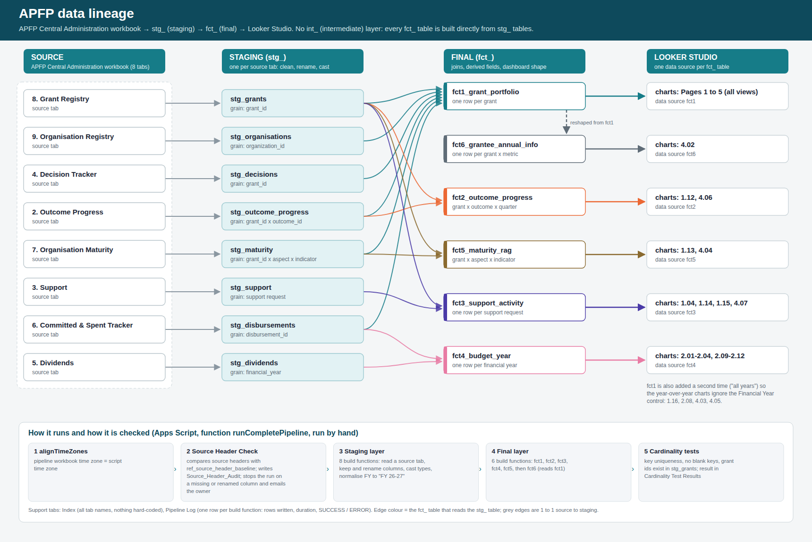
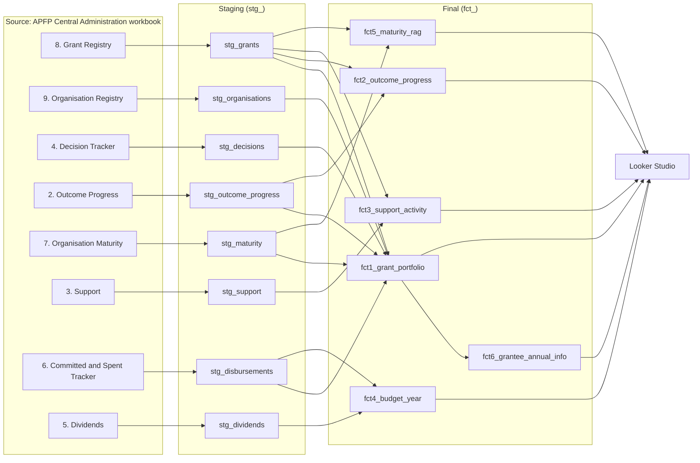

# APFP data lineage

**For clients: [`lineage/story/APFP_Data_Story.drawio`](lineage/story/APFP_Data_Story.drawio) (one page, plain words) plus the `Data_Dictionary` and `Chart_Passport` tabs in the Data Pipeline workbook.** The tabs are rebuilt on every run from `LineageData.js`; to change wording edit `docs/lineage/lineage_model.py` / `chart_passport.py` and run `python3 docs/lineage/export_catalog.py` and `python3 docs/lineage/make_story.py`.

**Technical, column-level, client-readable diagram (editable): [`lineage/APFP_Data_Lineage.drawio`](lineage/APFP_Data_Lineage.drawio)**, 16 pages, opens in app.diagrams.net, the draw.io desktop app or from Google Drive. PNG previews of every page are in `docs/lineage/preview/`. Pages: how the pieces fit, the journey of the data, source tabs, source to staging (3 pages), index of final tables, staging to final (one page per final table), from columns to dashboard numbers, three numbers traced step by step, glossary and key. To keep it in line with the code run `npm run lineage` (lists columns that are in the scripts but not in the diagram, and the reverse). The table-level picture below is the one-page summary.

Image files: `docs/lineage/data_lineage.png` (for documents and slides) and `docs/lineage/data_lineage.svg` (editable, scales without blur). To regenerate after a change: `python3 docs/lineage/make_svg.py docs/lineage/data_lineage.svg` (the table lists at the top of the script are the only thing to edit).

## Layers

| Layer | Prefix | What it is | Tabs |
|---|---|---|---|
| Source | none | The APFP Central Administration workbook. Read only; never written by the pipeline. | 8 tabs, listed below |
| Staging | `stg_` | One table per source tab: keep the pipeline columns, rename to `snake_case`, cast types, normalise financial year to `FY 26-27`. No joins, no business logic. | 8 tabs |
| Intermediate | `int_` | **Not used.** See "Why there is no intermediate layer". | none |
| Final | `fct_` | The tables the dashboard reads: joins, derived fields, display text and sort helpers. | 6 tabs |
| Consumption | none | Looker Studio, one data source per `fct_` table (plus an "all years" copy of `fct1`). | 5 pages |

## Source to staging (one to one)

| Source tab (Central Administration) | Staging table | Grain |
|---|---|---|
| 8. Grant Registry | `stg_grants` | one row per `grant_id` |
| 9. Organisation Registry | `stg_organisations` | one row per `organization_id` |
| 4. Decision Tracker | `stg_decisions` | one row per `grant_id` under decision |
| 2. Outcome Progress | `stg_outcome_progress` | one row per `grant_id` x `outcome_id` (Q1 to Q4 still wide) |
| 7. Organisation Maturity | `stg_maturity` | one row per `grant_id` x aspect x indicator |
| 3. Support | `stg_support` | one row per support request |
| 6. Committed & Spent Tracker | `stg_disbursements` | one row per `disbursement_id` |
| 5. Dividends | `stg_dividends` | one row per financial year |

## Staging to final (what each `fct_` table reads)

| Final table | Grain | Reads | Feeds (Looker Studio charts) |
|---|---|---|---|
| `fct1_grant_portfolio` | one row per grant | `stg_grants`, `stg_organisations`, `stg_decisions`, `stg_outcome_progress`, `stg_maturity`, `stg_disbursements` | pages 1 to 5 (all views) |
| `fct2_outcome_progress` | grant x outcome x reported quarter | `stg_outcome_progress`, `stg_grants` | 1.12, 4.06 |
| `fct3_support_activity` | one row per support request | `stg_support`, `stg_grants` | 1.04, 1.14, 1.15, 4.07 |
| `fct4_budget_year` | one row per financial year | `stg_dividends`, `stg_disbursements` | 2.01 to 2.04, 2.09 to 2.12 |
| `fct5_maturity_rag` | grant x aspect x indicator | `stg_maturity`, `stg_grants` | 1.13, 4.04 |
| `fct6_grantee_annual_info` | grant x metric | `fct1_grant_portfolio` | 4.02 |

`stg_grants` is joined into `fct2`, `fct3` and `fct5` only to add `organization_id`, `organisation`, `thematic_area` and `grant_status`, so that the dashboard filters reach every table.

## Why there is no intermediate layer

An `int_` table earns its place when the same joined or transformed data is needed by **several** final tables, or when a step is too complex to read in one go. Neither applies here:
- Each `fct_` table is one readable join of staging tables. The only shared lookup, `stg_grants`, is a simple key join and is not worth a table of its own.
- All derived logic (due windows, funding ranges, on-track status, the previous-year values) lives in one place, the `fct_` build function, and is documented in `PIPELINE_LOGIC.md`.
- `fct6` is the one table that reads another final table (`fct1`). It only reshapes `fct1` into metric rows with the selected and previous year side by side, so it is kept as a final table rather than an intermediate one. If a second table ever needs the same reshaping, that is the moment to introduce an `int_` layer.

## Control tabs (not part of the data flow)

| Tab | Role |
|---|---|
| `Index` | Every tab name is read from here; nothing is hard-coded in the scripts. |
| `ref_source_header_baseline` and `Source_Header_Audit` | Expected source headers and the result of the check. A missing or renamed source column stops the run and emails the owner. |
| `Pipeline Log` | One row per build function: rows written, duration, SUCCESS or ERROR. |
| `Cardinality Test Results` | Key uniqueness, no blank keys, every `grant_id` exists in `stg_grants`. |

## Run order (`runCompletePipeline`, run by hand)

1. `alignTimeZones`: the pipeline workbook uses the script's time zone.
2. Source Header Check (gate): stops the run on a critical problem.
3. Staging layer: 8 build functions.
4. Final layer: `fct1`, `fct2`, `fct3`, `fct4`, `fct5`, then `fct6` (it reads `fct1`).
5. Cardinality tests.

## Text version (renders on GitHub)

